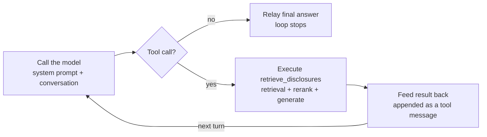

# Hand-Built Agent Loop — Design Doc

`src/agents/agent_loop.py` · `src/agents/tools.py` · `src/agents/conversation_store.py`

## Goal & Context

Module 8 of the course asks for a hand-built agent loop with no framework — the point is seeing what LangGraph and similar tools abstract away, not building something elaborate. The brief: the model picks between one tool call and two plain-text branches (ask a clarifying question, or say it doesn't know), the result gets fed back, and it repeats until done, with at most two or three tools.

The course's working method asks for a plain-language design before any code. As a beginner with no prior mental model of an agent loop, that wasn't achievable up front — the design here was written *after* a first working attempt, by narrating the code back in plain language and fixing what that narration couldn't explain. Building first and designing in retrospect is a legitimate substitute when the background knowledge to design confidently just isn't there yet.

Done when: the loop runs end-to-end on two question types — one that retrieves and answers, one that triggers a clarifying question — and the loop can be drawn from memory without looking at the code.

## Core Mechanism

A `max_turns` cap (default 5) guarantees the loop stops even if the model never gives a final answer.

Every turn ends one of two ways: a final text answer that stops the loop, or a tool call that gets executed and fed back in for the next turn.

## System Prompt & Tool

One real tool is wired to the model: `retrieve_disclosures` (`src/agents/tools.py`), which runs the full retrieval → rerank → generate pipeline and returns an `Answer` (`answer` text + the `parent_id`s it relied on) — not raw search hits. The system prompt (`SYSTEM_PROMPT` in `agent_loop.py`) gives the model three options per turn: call the tool if the question is specific enough to search; ask a clarifying question in plain text if it's missing a period, entity, or metric; or say outright that the question is out of scope.

The model can't actually check the real documents before deciding to call the tool — it's guessing from the question's phrasing and its own training, the same way it recognizes "What was CBA's NPAT for 1H26?" as the shape of a financial-disclosure question. That guess can be wrong in both directions, which is why the design doesn't lean on it being right: the tool call itself is how the model finds out whether the answer actually exists, and the prompt tells it to say so honestly if the tool comes back empty-handed, rather than trusting its own turn-1 guess.

## Stopping Conditions

Each call to `_call_model` returns a `ModelTurn(content, tool_calls, conversation)`. `run_loop` checks, in order: a non-empty `content` → return it, the loop is done; `tool_calls` present → execute `retrieve_disclosures`, append its result as a `{"role": "tool", ...}` message, and loop again; neither → return `"No response from the model."` (an abnormal case, not expected in normal operation).

A `for turn in range(max_turns)` (default 5) caps the loop as a hard guarantee — if the model never produces a final answer, the loop still terminates with `"I couldn't resolve this in a reasonable number of steps."` This is deliberately separate from the system prompt's own instruction to give up after 3 failed retrieval attempts: the prompt shapes when the model *chooses* to stop retrying, which depends on it following a meta-instruction correctly; the `max_turns` cap is enforced in code regardless of what the model decides, and is the only one of the two that actually guarantees termination.

## Conversation Resumption

`run_loop` takes an optional `reference_id` and always returns `(answer, reference_id)`. No id → a fresh conversation starts and a new id (`uuid4`) is generated; a valid id → the prior conversation is loaded and the new message continues it. This is what lets a clarifying question get answered in a follow-up call instead of being a dead end.

The cache (`ConversationStore`, `src/agents/conversation_store.py`) is a SQLite table (`agent_conversations`: `reference_id`, `conversation_json`, `last_touched`), not an in-memory dict — the first version built was in-memory, but testing it by running `scripts/run_agent_loop.py` twice from the terminal exposed the problem: each run is a fresh process with empty memory, so a second run has no way to see what the first one cached. SQLite survives between runs; that's the entire reason it's a table and not a dict.

`get_conversation` deletes every row older than `TTL_SECONDS` (30 minutes) *before* fetching, so a stale `reference_id` always behaves as "not found," and cleanup happens as a side effect of normal use. One real bug surfaced only by testing a resume across two separate processes: a freshly-generated assistant message's `tool_calls` are raw OpenAI SDK objects with a `.model_dump()` method, but a conversation that's round-tripped through the store once comes back with `tool_calls` as plain dicts (from `json.loads`) — re-saving it without checking `hasattr(tc, "model_dump")` crashed. Fixed by checking before converting.

## Deployment Considerations

An in-memory cache only works if the same process handles both halves of a conversation — true for a single long-running server (or Streamlit's own `st.session_state`, which is the same pattern), false for serverless. A Lambda-style deployment can route two calls from the same conversation to two different, memory-isolated execution environments; the second call would silently start over instead of erroring, which is worse than a crash. Horizontal scaling behind a load balancer has the same failure mode unless sessions are pinned to one instance, which is itself a fragile workaround. SQLite (or any store every instance can reach) is what makes the resume mechanism correct independent of how this ends up deployed.

## Bugs Found & Fixed

- **`tool_calls` serialization** (see Conversation Resumption) — only visible by actually resuming a conversation across two separate processes, not by reasoning about the code.
- **Cost under-counting**: the demo script's printed total initially summed only `AgentLoop`'s own two model calls, missing the embedding and generation calls made *inside* `RetrievalTool`. Fixed by exposing `RetrievalTool` as `self.tool` in `AgentLoop.__init__` (previously a local variable, invisible from outside) and summing all three `finops` instances.
- **No return value**: the first working version of `run_loop` computed an answer but never returned it — caught before ever running it, by tracing the stop conditions by hand.

Each of these was found by actually running the code against real APIs, not by code review alone — consistent with this project's working method of treating an untested claim as unverified.

## Testing

`tests/agents/test_agent_loop.py` and `tests/agents/test_conversation_store.py` cover this module, offline and mocked — no real OpenAI/Cohere calls, no writes to the real `data/` files. `AgentLoop`'s tests mock `RetrievalTool` and `ConversationStore` at construction (both default to real files when unconfigured) and exercise the real branching logic: starting fresh vs. resuming by `reference_id`, the full tool-call round trip (checking the tool's result actually lands in the *next* model call's messages, not just that a mock was called), the `max_turns` cap terminating a loop that never gives a final answer, and the empty-response fallback.

`ConversationStore`'s tests use a real temporary SQLite file instead of mocking — that module's job *is* the SQL logic, so a mock would test nothing real. They cover the delete-before-fetch behavior directly: not just that an expired lookup returns empty, but that the row is actually gone from the table afterward, and that sweeping one expired conversation doesn't touch other valid ones. One test is a direct regression for the `model_dump`/plain-dict bug above.

## Open Items & Future Work

- **Cleanup is still inline, not automated.** `get_conversation`'s delete-before-fetch is a pragmatic stand-in for a single hand-built script. The comment in the code is explicit about this: cleaning up expired conversations should be a separate background thread (or scheduled job) in a real deployment, decoupled from request handling entirely — not implemented here, intentionally.
- **No UI wiring.** The clarify-then-resume flow has only been exercised through `scripts/run_agent_loop.py` and ad hoc scripts, never through `app.py`'s Streamlit interface, which still talks directly to `TwoStageRetriever`/`AnswerGenerator` rather than `AgentLoop`.
- **Single tool.** `retrieve_disclosures` is the only real tool; "ask a clarifying question" and "say it doesn't know" are plain-text model turns shaped by the prompt, not separate tools — a deliberate choice to stay within the module's two-or-three-tool ceiling, not a limitation discovered later.
